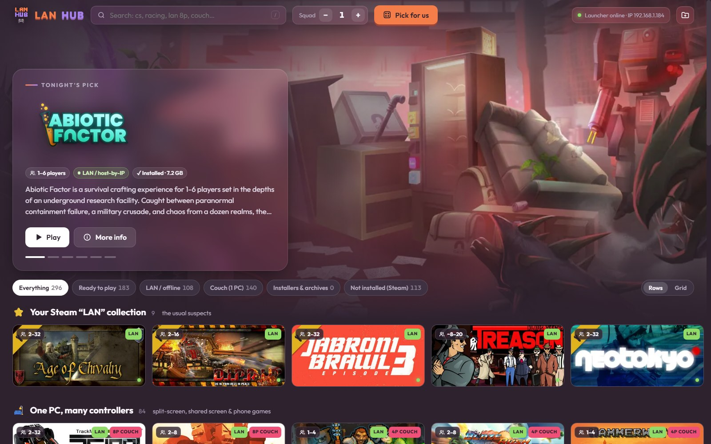
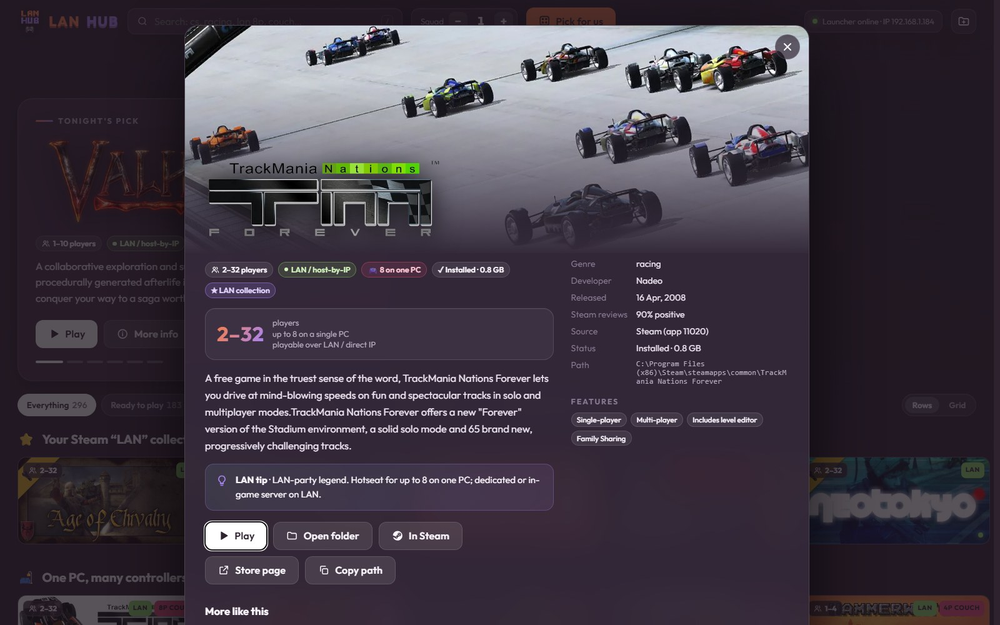
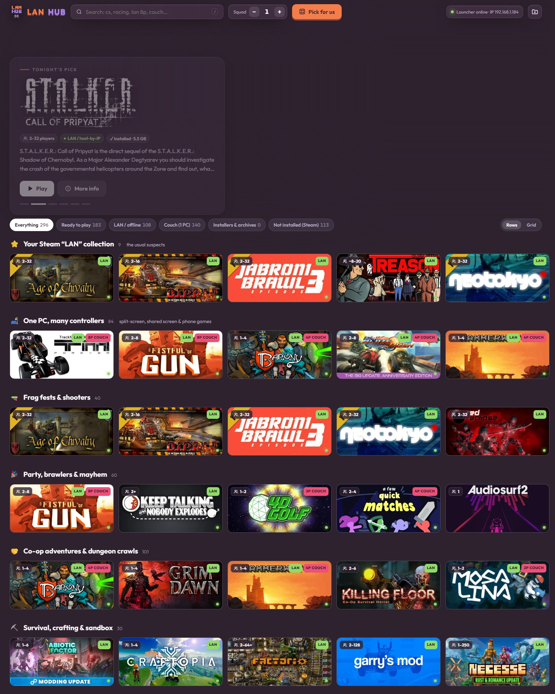

# LAN Hub

A local, privacy-first launcher for LAN parties. It finds your Steam games, Xbox app / Game Pass games and the
classics, installers and archives in your game folders, shows player counts and LAN tips, and starts them from
one page. It reads only the folders you allow and listens on `127.0.0.1` only.



| | |
|---|---|
|  |  |

## What it does

- **One page for everything**: Steam (installed and in your library), Xbox app / Game Pass, GOG installers,
  portable games, zips, ISOs and installers in your LAN folder.
- **Made for parties**: player counts, "fits all N of you", couch / split-screen games, LAN or online-only,
  host-by-IP tips, and a *Pick for us* roulette.
- **Install → Play**: an installer tile says **Install**. When the installer closes, LAN Hub sees where the game
  went (Windows' installed-apps list) and the tile turns into **Play**. You can also point it at the exe yourself.
- **Finds the usual places**: Steam libraries on any drive, `XboxGames` folders, GOG Galaxy, Epic, EA, Ubisoft
  and `Games` folders are suggested on first run. Nothing is read before you approve it.
- **Updates itself** from this repo's GitHub releases, when you click Update and only after the download
  matches GitHub's published checksum.

## Privacy and safety

The first start shows a permission screen. Nothing is scanned until you answer it, and you can change it later.

| Permission | What it reads / contacts |
|---|---|
| Steam library | Steam's own files: library, collections, cached artwork. Never your account or login. |
| Game folders | Only the folders you tick, a few levels deep. |
| Artwork & descriptions | Only `store.steampowered.com`, the Steam CDN, `en.wikipedia.org`, `upload.wikimedia.org`. |
| Installed apps | Windows' installed-apps list, to find where an installer put a game. |
| Updates | Only `api.github.com` and GitHub's download servers, for this repo. |

Always:
- It serves on `127.0.0.1`. Other PCs on your network can't reach it, and it rejects requests from other websites.
- It only starts games, installers and folders it found in what you allowed, or an exe you picked yourself.
- It only writes inside its own folder.
- It's short, readable code: `app/tools/*.py` (Python) and `app/launcher/LANHub.cs` (the tray launcher).

## Download

Get `LAN-Hub-<version>.zip` from [Releases](../../releases), extract it anywhere, and double-click
**LAN Hub.exe**. It sits in the system tray and opens the hub in your browser. The zip includes the official
portable Python, so nothing else needs to be installed.

**Uninstall:** quit LAN Hub from the tray icon and delete the folder. It installs nothing and changes nothing
outside its own folder (no registry entries, no autostart, no files elsewhere).

## Run from source

```
git clone https://github.com/NeonChicken/lan-hub.git
cd lan-hub
app\launcher\build.bat                      :: builds LAN Hub.exe with the C# compiler that ships with Windows
"app\Start LAN Hub (fallback).bat"          :: or run the server directly (uses Python 3.8+ or downloads the portable one)
```

## Curating your own games

- `app/tools/curation.py` holds the public metadata: player counts, LAN flags and tips for Steam games, plus a
  catalog of classic non-Steam games recognised by file name.
- Your own games, paths and notes go in `app/tools/curation_local.py`, which git ignores. Start from
  `app/tools/curation_local.example.py`.
- `python app/tools/package.py --friends` makes a zip for your LAN party that includes your
  `curation_local.py` and artwork cache. Plain `package.py` makes the public build.

## Releasing

Push a tag `vX.Y.Z` that matches `VERSION` in `app/tools/config.py`. The
[release workflow](.github/workflows/release.yml) builds the exe, adds the portable Python (checked against its
SHA-256), packages `LAN-Hub-X.Y.Z.zip` plus a `.sha256`, and creates a draft release for you to review and publish.

## Code signing policy

Free code signing provided by [SignPath.io](https://about.signpath.io/), certificate by
[SignPath Foundation](https://signpath.org/). *(Applied for: releases are signed once the project is approved.)*

Only `LAN Hub.exe` is signed, and only when it is built from this repository by the
[release workflow](.github/workflows/release.yml). The bundled Python is the official build, already signed by
the Python Software Foundation.

| Role | Members |
|---|---|
| Committers and reviewers | [NeonChicken](https://github.com/NeonChicken) |
| Approvers (every signing request) | [NeonChicken](https://github.com/NeonChicken) |

**Privacy policy:** this program will not transfer any information to other networked systems unless
specifically requested by the user or the person installing or operating it. Each kind of network access is a
separate permission on the first-start screen (see [Privacy and safety](#privacy-and-safety)), and each can be
turned off.

## License

[MIT](LICENSE) © NeonChicken. The bundled Outfit font is OFL-licensed, and Python is under the PSF license.
Game names and artwork belong to their owners. They're downloaded on your own PC and are not part of this repo.
